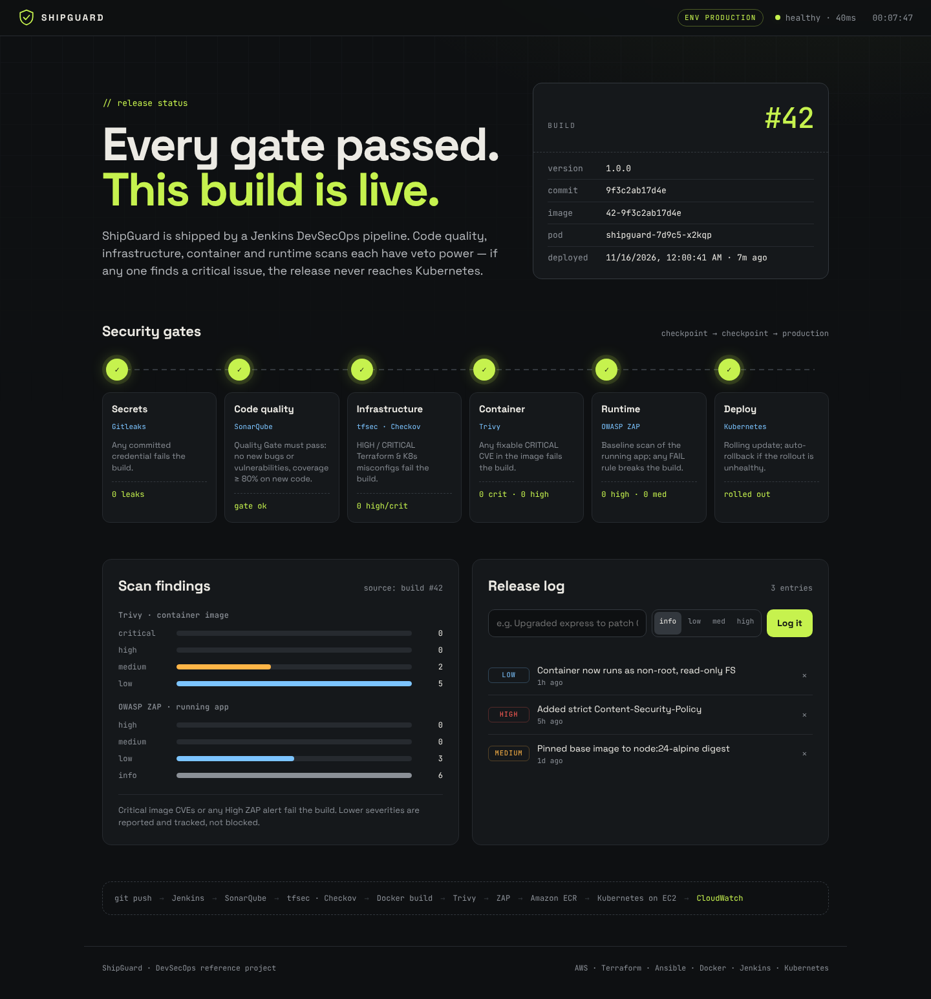

# ShipGuard: DevSecOps Pipeline on AWS

A Jenkins pipeline where **every release has to pass five security gates** before it can reach Kubernetes:

| Gate | Tool | Fails the build when… |
|---|---|---|
| 0 · Secrets | **Gitleaks** | any credential is committed |
| 1 · Code quality | **SonarQube** | the Quality Gate fails (bugs, vulnerabilities, coverage on new code) |
| 2 · Infrastructure | **tfsec + Checkov** | Terraform or Kubernetes manifests have HIGH/CRITICAL misconfigurations |
| 3 · Container | **Trivy** | the Docker image has a fixable CRITICAL CVE |
| 4 · Runtime | **OWASP ZAP** | the running app triggers a FAIL rule or any High-risk alert |
| Deploy | **Kubernetes (k3s)** | the rollout is unhealthy (auto-rollback) |

The app is **ShipGuard**, a deployment console that shows the live build number, pod, image and the scan results from the pipeline that shipped it.



---

## Architecture

```
 You ──git push──▶ GitHub
                     │  (Jenkins polls every 2 min)
                     ▼
 ┌──────────── AWS · us-east-1 / ap-south-1 · VPC 10.20.0.0/16 ─────────────────────────────┐
 │                                                                                │
 │  EC2 "jenkins" (t3.large)                    EC2 "k8s" (t3.small)              │
 │  ┌──────────────────────────────┐            ┌──────────────────────────┐      │
 │  │ Jenkins  ── Gitleaks          │  kubectl   │ k3s (Kubernetes)         │      │
 │  │          ── SonarQube (Docker)│ ─────────▶ │  ns: shipguard           │      │
 │  │          ── tfsec / Checkov   │   :6443    │   2 × ShipGuard pods     │      │
 │  │          ── Trivy             │            │   NodePort :30080 ◀── You│      │
 │  │          ── OWASP ZAP         │            └───────────▲──────────────┘      │
 │  └───────┬──────────────┬────────┘                        │ pull (by digest)   │
 │          │ push         │ reports                         │                    │
 │          ▼              ▼                                  │                    │
 │      Amazon ECR     S3 (reports)        CloudWatch: logs, metrics, alarms ─▶ SNS email
 │      (KMS, scan     (KMS, versioned)    dashboard, VPC flow logs               │
 │       on push)                                                                 │
 └────────────────────────────────────────────────────────────────────────────────┘
```

**AWS services used:** EC2, VPC, Security Groups, IAM roles (no access keys on servers), ECR, S3, KMS, CloudWatch (Logs, Metrics, Alarms, Dashboard, VPC Flow Logs), SNS, Systems Manager.

## Repository layout

```
.
├── Jenkinsfile               # the pipeline with all gates
├── app/                      # Node.js app + Dockerfile + tests + sonar-project.properties
├── terraform/                # all AWS infrastructure (passes its own tfsec/Checkov gate)
├── ansible/                  # configures Jenkins, SonarQube, Trivy, k3s, CloudWatch agent
├── k8s/                      # hardened manifests (non-root, read-only FS, NetworkPolicy, PDB)
├── security/                 # ZAP rules, Trivy ignore file
├── scripts/                  # deploy, smoke test, scan summary
└── docs/
```

## Cost (read this first)

**On AWS Academy Learner Lab ($50 credit):** both servers plus 2 Elastic IPs cost about **$0.12/hour** in us-east-1, so $50 covers roughly **400 hours** of lab time. Learner Lab stops the instances when your session ends, which saves credit automatically. Still click **End Lab** when you finish for the day.

**On your own AWS account:**

| Resource | Approx. cost (Mumbai) |
|---|---|
| t3.large Jenkins | ~$0.09/hour |
| t3.small k8s | ~$0.024/hour |
| EBS 60 GB gp3, KMS key, CloudWatch, ECR, S3 | ~$7–8/month |

About **$3/day while running**. **Stop both instances** in the EC2 console when you're not working, and run `terraform destroy` when you're done (Step 12). Set a budget alert in Step 1.

---

# Step-by-step guide

## Step 0: Install the tools on your laptop

On **Windows, use WSL2 (Ubuntu)**, because Ansible doesn't run natively on Windows. On Mac, use Homebrew.

| Tool | Check |
|---|---|
| Git | `git --version` |
| AWS CLI v2 | `aws --version` |
| Terraform ≥ 1.6 | `terraform -version` |
| Ansible ≥ 2.15 | `ansible --version` (`pip install ansible`) |
| Node.js 24 (optional, to run the app locally) | `node -v` |

Create an SSH key for the servers:

```bash
ssh-keygen -t ed25519 -f ~/.ssh/shipguard -N ""
```

## Step 1: Prepare your AWS account (AWS Console)

### Option A: AWS Academy Learner Lab ($50 credit), the likely case for you

Learner Lab has three rules that matter here. You **can't create IAM users or roles** (you use the ready-made `LabRole`/`LabInstanceProfile`), only **us-east-1 and us-west-2** are allowed, and a session lasts **4 hours**, after which EC2 instances are stopped (they start again with the next session).

1. Open your course → **Modules → Launch AWS Academy Learner Lab → Start Lab**. Wait for the dot next to "AWS" to turn **green**.
2. Click **AWS Details → AWS CLI: Show**. Copy the whole block into `~/.aws/credentials` (it has an `aws_session_token` line too):
   ```bash
   mkdir -p ~/.aws && nano ~/.aws/credentials     # paste, save
   aws configure set region us-east-1
   aws sts get-caller-identity                     # shows assumed-role/voclabs/...
   ```
3. Click **AWS** (the green dot) to open the console. Make sure the region at top-right is **N. Virginia (us-east-1)**.
4. Skip Budgets, which Learner Lab doesn't allow. The remaining credit is shown on the Learner Lab page.
5. In Step 4, keep the three Learner Lab lines in `terraform.tfvars` (`learner_lab = true`, `aws_region = "us-east-1"`, `availability_zone = "us-east-1a"`).

> **Each new Learner Lab session:** Start Lab → paste the new credentials into `~/.aws/credentials` again (they expire after 4 hours) → if your home IP changed, update `my_ip_cidr` and run `terraform apply`. The instances, Jenkins, SonarQube and k3s come back on their own, and the Elastic IPs keep the same addresses, so the URLs don't change.

### Option B: Your own AWS account


1. Sign in as root **only** to turn on MFA for root (IAM → Security credentials).
2. **IAM → Users → Create user** `devops-admin`, attach `AdministratorAccess` (fine for a personal lab), enable MFA.
3. Under that user, **Security credentials → Create access key → CLI**. On your laptop:
   ```bash
   aws configure        # region: ap-south-1, output: json
   aws sts get-caller-identity   # should show devops-admin
   ```
4. **Billing → Budgets → Create budget → Monthly cost budget** of $15 with an email alert. This protects you from surprise bills.

## Step 2: Run the app locally (optional, 2 minutes)

```bash
cd app
npm install
npm test          # 7 tests + coverage
npm start         # http://localhost:3000
```

## Step 3: Push the project to GitHub

Create a **public** repo (simplest for Jenkins; for private, see the Troubleshooting section), then:

```bash
git init && git add . && git commit -m "ShipGuard DevSecOps pipeline"
git branch -M main
git remote add origin https://github.com/<you>/shipguard-devsecops.git
git push -u origin main
```

`.gitignore` already keeps `terraform.tfvars`, state files and the generated inventory out of git.

## Step 4: Provision AWS with Terraform

```bash
cd terraform
cp terraform.tfvars.example terraform.tfvars
curl -s https://checkip.amazonaws.com     # put this IP + /32 into my_ip_cidr
# edit terraform.tfvars: my_ip_cidr, alert_email, owner
# Learner Lab: keep learner_lab = true + us-east-1 lines. Own account: delete those 3 lines.

terraform init
terraform fmt -check && terraform validate
terraform plan -out tfplan       # read it! ~60 resources
terraform apply tfplan
```

When it finishes, Terraform prints the URLs and **writes `ansible/inventory/hosts.ini` for you**.

**Do these now:**
- Open your email and **confirm the SNS subscription** ("AWS Notification - Subscription Confirmation").
- Take a quick tour in the **AWS Console** (useful screenshots for your portfolio):
  - **EC2 → Instances:** `shipguard-jenkins` and `shipguard-k8s`. Open one → *Security* tab → IAM role, IMDSv2 "required", encrypted volume.
  - **VPC → Your VPCs → shipguard-vpc → Flow logs**
  - **ECR → shipguard:** scan on push, immutable tags, KMS
  - **S3 → shipguard-reports-<account>:** versioning, KMS, public access blocked
  - **CloudWatch → Dashboards → shipguard**, **Alarms**, and **Log groups** `/shipguard/*`

> Optional (recommended): move state to S3. Create a bucket `shipguard-tfstate-<account-id>` with versioning on, uncomment the `backend "s3"` block in `versions.tf`, then run `terraform init -migrate-state`.

## Step 5: Configure the servers with Ansible

```bash
cd ../ansible
ansible-galaxy collection install -r requirements.yml
ansible all -m ping                       # both hosts should answer "pong"
ansible-playbook playbooks/site.yml       # ~10–15 minutes
```

What it does:
- **Both servers:** base packages, automatic security updates, AWS CLI v2, CloudWatch agent (memory/disk metrics plus syslog, auth.log, Jenkins build logs and app container logs)
- **k8s:** installs k3s with secrets encryption, then a cron job that refreshes the ECR pull secret every 6 hours
- **jenkins:** Docker, Java 21, Jenkins and its plugins, Trivy, kubectl, SonarQube (Docker), the kubeconfig for the cluster, the ECR credential helper (it uses the instance role, so no AWS keys are stored), and `/etc/shipguard/pipeline.env`

At the end it prints the **Jenkins initial admin password** and the **SonarQube webhook URL**. Copy both.

## Step 6: Set up SonarQube

> **Optional.** SonarQube is off by default (the stage shows as skipped). To use it, do this step and Step 7.2–7.3, then run **Build with Parameters → tick RUN_SONARQUBE**.

Open `http://<jenkins-ip>:9000`. It takes about 2 minutes to start the first time.

1. Log in `admin` / `admin` and set a new password.
2. **My Account (top-right) → Security → Generate token.** Name: `jenkins`, Type: *Global Analysis Token*. **Copy it.**
3. **Administration → Configuration → Webhooks → Create.** Name: `jenkins`. URL: `http://<jenkins-PRIVATE-ip>:8080/sonarqube-webhook/` (Ansible printed it). This is how Jenkins learns the Quality Gate result.

## Step 7: Set up Jenkins

Open `http://<jenkins-ip>:8080`.

1. Paste the initial admin password → **Install suggested plugins** → create your admin user.
2. **Manage Jenkins → Credentials → System → Global → Add credentials**
   - Kind: *Secret text*, Secret: the SonarQube token, ID: `sonar-token`
3. **Manage Jenkins → System → SonarQube servers**
   - Check *Environment variables*
   - Name: `sonarqube` (must match the Jenkinsfile), URL: `http://localhost:9000`, token: `sonar-token` → **Save**
4. **New Item →** `shipguard` → **Pipeline → OK**
   - *Pipeline → Definition:* **Pipeline script from SCM**, SCM: Git, URL: your repo, branch `*/main`, Script Path: `Jenkinsfile`
   - **Save**

## Step 8: Run the pipeline

Click **Build Now**. The first run takes about 8–10 minutes while the Trivy DB and images download; later runs take 3–5 minutes. Watch the **Stage View**:

```
Init → Secrets → Unit tests → SonarQube → IaC (tfsec ∥ Checkov) → Build → Trivy → ZAP → Push ECR → Deploy → Smoke test
```

When it's green, open **`http://<k8s-ip>:30080`**. The dashboard shows *your* build number, commit, pod name and the real scan counts from this run.

Where to look:
- **Jenkins → build → Artifacts:** every report (`gitleaks.json`, `tfsec.json`, `results_json.json`, `trivy-image.json`, `zap.html`, `scan-summary.json`)
- **Jenkins → OWASP ZAP report** (left menu)
- **SonarQube → Projects → ShipGuard:** bugs, smells, coverage
- **S3 → shipguard-reports-… → builds/<n>/:** the same reports, kept for 90 days
- **ECR → shipguard:** the image, plus AWS's own scan result

From now on, every `git push` is picked up within 2 minutes.

## Step 9: Prove the gates work (do this, because it's the best part of the demo)

Break one thing at a time, push, screenshot the red stage, then revert. These "failed build" screenshots are what recruiters remember.

| Demo | Change | Gate that blocks it |
|---|---|---|
| Leaked secret | `echo "token = ghp_$(openssl rand -hex 18)" > app/leak.txt` | Gitleaks |
| Open SSH to the world | in `terraform/security_groups.tf`, set `jenkins_ssh` → `cidr_ipv4 = "0.0.0.0/0"` | tfsec (CRITICAL) + Checkov |
| Root container | in `k8s/deployment.yaml`, set `runAsNonRoot: false` | Checkov |
| Vulnerable base image | in `app/Dockerfile`, use runtime `FROM node:16-alpine` | Trivy |
| Leaky server header | in `app/src/app.js`, before the routes add `app.use((q, r, n) => { r.setHeader('Server', 'Apache/2.4.1'); n(); });` | OWASP ZAP (rule 10036) |
| Insecure code | add `app.get('/calc', (q, r) => r.send(String(eval(q.query.x))));` | SonarQube Quality Gate |

**Important for the secrets demo:** Gitleaks scans the whole git history, so after that demo remove the commit, not just the file:
```bash
git reset --hard HEAD~1 && git push --force
```

## Step 10: Observe with CloudWatch

- **Dashboards → shipguard:** CPU and memory for both servers, app errors, latest app logs
- **Logs Insights** on `/shipguard/app`: `fields @timestamp, @message | sort @timestamp desc`
- **Alarms:** CPU > 80%, memory > 90% and status-check failures email you through SNS. To test one: `ssh` to the k8s node and run `yes > /dev/null &` for 10 minutes (then `kill %1`).
- **VPC flow logs** (`/shipguard/vpc-flow-logs`) show rejected connection attempts from the internet. (Own account only: flow logs need their own IAM role, so they are switched off in Learner Lab mode.)

## Step 11: Extensions (optional, if you want to stand out more)

- Replace k3s with **Amazon EKS** (`terraform-aws-modules/eks`; costs about $0.10/hour more)
- Add an **Application Load Balancer + ACM certificate** for HTTPS, then turn on HSTS in `app/src/app.js`
- Jenkins **agents on EC2** instead of building on the controller
- **Slack notifications** in the `post {}` block
- Sign images with **Cosign** and verify them before deploy
- **Argo CD** (GitOps) for the deploy stage

## Step 12: Tear everything down

```bash
cd terraform
terraform destroy
```

ECR images and S3 reports are deleted too (`force_delete` / `force_destroy` are on for the lab). Then check **EC2 → Volumes** and **Elastic IPs** in the console for leftovers. Note that the KMS key is scheduled for deletion after 7 days.

---

## Security design decisions (talking points for interviews)

- **No long-lived AWS keys on servers.** Jenkins and the k8s node use IAM instance roles. Docker pushes through the ECR credential helper.
- **Least privilege.** The Jenkins role can push only to the `shipguard` ECR repo and write only to `builds/*` in the reports bucket.
- **Deploy by digest.** The pod runs `repo@sha256:…`, the exact bytes Trivy and ZAP scanned. Tags are also immutable in ECR.
- **Defense in depth on the pod.** Non-root UID 10001, read-only root filesystem, all Linux capabilities dropped, seccomp `RuntimeDefault`, no service account token, Pod Security Admission `restricted`, default-deny NetworkPolicy.
- **Encryption everywhere.** One KMS customer-managed key (with rotation) covers S3, ECR, CloudWatch Logs and SNS. EBS is encrypted, IMDSv2 is enforced, and S3 denies non-TLS access.
- **Network.** Every port is open only to your IP. The Kubernetes API is reachable only from the Jenkins security group. The default SG is locked down.
- **The infrastructure scans itself.** The Terraform in this repo passes its own tfsec/Checkov gate. Every suppression has a written justification in a `#checkov:skip` comment (for example, the public subnet is there to avoid NAT Gateway cost).
- **Gate thresholds are deliberate.** Block on CRITICAL/HIGH, report the rest, so teams don't learn to ignore a pipeline that is always red.

## Resume bullets

- Built a Jenkins **DevSecOps pipeline** with 5 automated security gates (Gitleaks, SonarQube, tfsec/Checkov, Trivy, OWASP ZAP) that block deployment to **Kubernetes** on critical findings.
- Provisioned **AWS** infrastructure (VPC, EC2, ECR, S3, KMS, IAM, CloudWatch, SNS) with **Terraform**, and configured servers with **Ansible**. The IaC passes 205 Checkov checks with zero HIGH/CRITICAL tfsec findings.
- Hardened workloads with least-privilege IAM roles, digest-pinned images, non-root read-only containers, NetworkPolicies and KMS encryption. Added **CloudWatch** dashboards and alarms with email alerts.

---

## Troubleshooting

| Symptom | Fix |
|---|---|
| `ExpiredToken` / `InvalidClientTokenId` in Terraform or AWS CLI | Learner Lab session expired. Start Lab again and paste the new **AWS Details** credentials. |
| `AccessDenied ... iam:CreateRole` | You're on Learner Lab but `learner_lab = true` is missing from `terraform.tfvars`. |
| `UnauthorizedOperation` / instance type not allowed | Learner Lab only allows us-east-1/us-west-2 and instance sizes up to *large*. Check `aws_region` and `availability_zone`. |
| `AccessDenied` on `kms:CreateKey` (Learner Lab) | Your lab blocks customer-managed KMS keys. Ask your instructor, or tell me and I'll switch the project to AWS-managed encryption. |
| `ansible all -m ping` times out | Your IP changed. Update `my_ip_cidr`, run `terraform apply`. |
| SonarQube container keeps restarting | `docker logs sonarqube`. Usually `vm.max_map_count`; re-run the jenkins playbook. |
| Quality Gate stage hangs, then times out | The SonarQube webhook is missing or wrong (Step 6.3). It must use the Jenkins **private** IP and end with `/sonarqube-webhook/`. |
| `permission denied ... docker.sock` | Jenkins wasn't restarted after joining the `docker` group: `sudo systemctl restart jenkins`. |
| `cat: /etc/shipguard/pipeline.env: No such file` | Re-run `ansible-playbook playbooks/site.yml`. |
| Pods stuck in `ImagePullBackOff` | ECR secret expired. Run `sudo /usr/local/bin/ecr-refresh.sh` on the k8s node. |
| Jenkins apt key error during Ansible | Jenkins rotated its signing key. Update the key URL in `ansible/playbooks/jenkins.yml` from https://pkg.jenkins.io/debian-stable/. |
| Private GitHub repo | Add a GitHub **Personal Access Token** as a *Username with password* credential and select it in the job's SCM settings. |
| Build fails at Trivy on a new CVE | Expected, because the gate is working. Bump the base image, or (with a reason and expiry date) add the CVE to `security/.trivyignore`. |
| ZAP stage fails | Open the **OWASP ZAP report** in Jenkins. FAIL rules are listed in `security/zap-baseline.conf`. |
